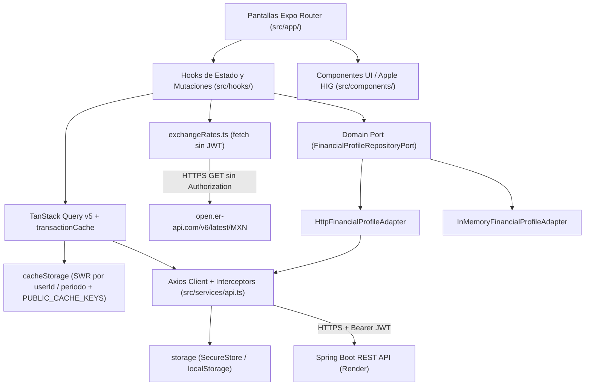
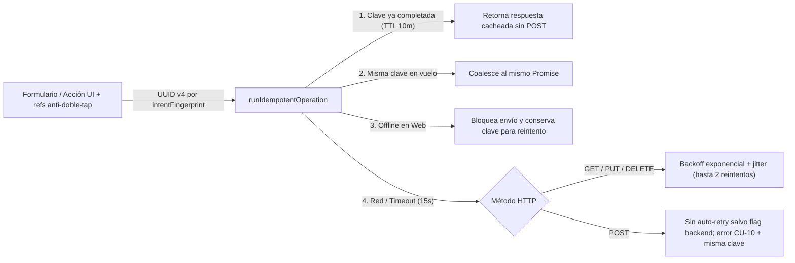

# ✨ Zentia — Finanzas Personales Multiplataforma

> **Claridad financiera en cada movimiento.** Aplicación móvil y web (`iOS`, `Android` y `Web`) orientada a registrar ingresos, gastos y metas de ahorro sin fricción, con arquitectura desacoplada, caché consistente e interfaz fluida.

---

## Tabla de Contenidos

1. [Qué es y Propósito](#qué-es-y-propósito)
2. [Stack Tecnológico](#stack-tecnológico)
3. [Arquitectura Frontend](#arquitectura-frontend)
4. [Arquitectura Distribuida & Replicación de Base de Datos](#arquitectura-distribuida--replicación-de-base-de-datos)
5. [Matriz CRUD Completa](#matriz-crud-completa)
6. [API REST Pública de Tipo de Cambio (ExchangeRate-API)](#api-rest-pública-de-tipo-de-cambio-exchangerate-api)
7. [Estrategia de Caché, Optimistic UI y Skeletons](#estrategia-de-caché-optimistic-ui-y-skeletons)
8. [Idempotencia, Reintentos y Resiliencia de Red](#idempotencia-reintentos-y-resiliencia-de-red)
9. [Integración con Backend (REST + JWT)](#integración-con-backend-rest--jwt)
10. [Testing y Verificación Automatizada](#testing-y-verificación-automatizada)
11. [Trade-offs de Diseño y Decisiones Técnicas](#trade-offs-de-diseño-y-decisiones-técnicas)
12. [Estructura del Proyecto](#estructura-del-proyecto)
13. [Configuración, Comandos y Despliegue](#configuración-comandos-y-despliegue)

---

## Qué es y Propósito

**Zentia** resuelve un problema cotidiano en herramientas de finanzas personales: la alta fricción para capturar movimientos diarios y la falta de visibilidad inmediata del balance real frente a una meta de ahorro mensual.

El cliente está diseñado bajo tres pilares:

- **Captura rápida con validación de dominio en cliente:** obliga montos estrictamente positivos (`RN-FIN-01`), filtra categorías compatibles por tipo de movimiento (`RN-FIN-03`) y normaliza contratos entre cliente y API.
- **Resiliencia ante latencia o cold-starts:** implementa hidratación síncrona en Web, caché con TTL por usuario y periodo, y skeletons OLED que reemplazan estados en `$0.00` durante cargas lentas en Render.
- **Paridad Multiplataforma con enfoque Mobile-First:** un mismo codebase con Expo Router sirve bundles estáticos en Vercel (`max-w-md` centrado en escritorio) y experiencia nativa en iOS/Android con Keychain/Keystore y desbloqueo biométrico (Face ID / Touch ID).

---

## Stack Tecnológico

| Capa | Tecnología | Versión / Detalle en repo |
| :--- | :--- | :--- |
| **Core & Runtime** | Expo SDK / React Native / React | `expo ~57.0.29` · `react-native 0.86.3` · `react 19.2.3` |
| **Navegación** | Expo Router (file-based + static web) | `expo-router ~57.0.27` |
| **Estilos & Sistema Visual** | NativeWind v4 + Tailwind CSS | `nativewind ^4.2.7` · `tailwindcss ^3.4.19` |
| **Estado Remoto & Caché** | TanStack Query v5 + `cacheStorage` | `@tanstack/react-query ^5.104.5` |
| **Red & Auth** | Axios + `fetch` público + `@react-oauth/google` | `axios ^1.20.0` · `@react-oauth/google ^0.13.5` |
| **Seguridad Nativa** | `expo-secure-store` + `expo-local-authentication` | Cifrado hardware en móvil y bloqueo biométrico |
| **Tipado & Testing** | TypeScript + Node Test Runner (`scripts/run-tests.mjs`) | `typescript ~6.0.3` (`strict` via `pnpm tsc --noEmit` + `pnpm test`) |

---

## Arquitectura Frontend

El proyecto separa estrictamente el **enrutamiento**, la **capa de presentación**, la **gestión de estado/caché** y el **dominio/infraestructura**:



### Principios aplicados

1. **Separación de rutas vs lógica (`src/app/` delgado):**
   - `(auth)`: bienvenida, login con Google OAuth y respaldo OTP por teléfono.
   - `(onboarding)`: wizard de 3 pasos + resumen que persiste ingreso base, meta del 20% y categoría prioritaria.
   - `(tabs)`: Dashboard (`index`), Historial filtrable/buscable (`transactions`) y Perfil (`profile`, ubicación exclusiva de `KaluriPromoCard` y `StandQRCard`).
   - `(modal)`: sheets modales (`presentation: 'modal'`) para alta y edición de transacciones.
2. **Ports & Adapters (Hexagonal) en Perfil Financiero:**
   - `FinancialProfile` (`src/domain/models/FinancialProfile.ts`) y `FinancialProfileRepositoryPort` (`src/domain/ports/FinancialProfileRepositoryPort.ts`) aíslan las pantallas del origen de datos.
   - `HttpFinancialProfileAdapter` sincroniza con Spring Boot (`/users/financial-profile` y `/users/onboarding`), mientras `InMemoryFinancialProfileAdapter` mantiene copia aislada bajo su propia llave (`zentia_financial_profile`) sin colisionar nunca con `zentia_user_data`.
3. **Ciclo de sesión e interceptor centralizado (`AuthContext` + `api.ts`):**
   - Al arrancar (`bootstrap`), `AuthProvider` valida la integridad del objeto usuario guardado (`isValidStoredUser`), restaura el token inmediatamente y ejecuta `syncSessionWithBackend` contra `GET /users/financial-profile` para mantener sincronizado `onboardingCompleted` y reparar sesiones incompletas.
   - Cualquier respuesta HTTP `401` dispara `storage.clearSession()`, limpia todas las cachés privadas (`cacheStorage.clearUserCaches()`, conservando llaves públicas como `categories` y `fx_rates_mxn`), resetea `QueryClient` vía `setUnauthorizedHandler` y redirige a `/(auth)/login`.

---

## Arquitectura Distribuida & Replicación de Base de Datos

Zentia opera sobre una topología distribuida multi-servidor donde la capa estática de presentación, la API transaccional, la persistencia relacional y los servicios públicos externos residen en nodos independientes conectados por HTTPS y políticas CSP estrictas:

```mermaid
flowchart LR
    USER["Navegador Web / App Nativa iOS & Android"]
    subgraph EDGE["1. Edge / CDN Estático (Vercel)"]
        CDN["Vercel Static Web CDN (dist/ + vercel.json CSP)"]
    end
    subgraph APP["2. Backend API (Render)"]
        SB["Spring Boot REST API + Spring Security JWT"]
        ROUTER["AbstractRoutingDataSource + LazyConnectionDataSourceProxy"]
    end
    subgraph DATA["3. Capa PostgreSQL (Supabase + Réplica de Lectura)"]
        PRIMARY[("Supabase PostgreSQL Primario (Lectura/Escritura)")]
        REPLICA[("Réplica / Secundario PostgreSQL (Solo Lectura)")]
    end
    subgraph EXT["4. Servicios Externos Públicos"]
        FXAPI["ExchangeRate-API (https://open.er-api.com/v6/latest/MXN)"]
        OAUTH["Google OAuth (accounts.google.com / oauth2.googleapis.com)"]
    end

    USER -->|Descarga bundle Web estático| CDN
    USER -->|HTTPS + Bearer JWT| SB
    USER -->|HTTPS GET sin JWT| FXAPI
    USER -->|OAuth 2.0 Token| OAUTH
    SB --> ROUTER
    ROUTER -->|"@Transactional (POST/PUT/DELETE)"| PRIMARY
    ROUTER -->|"@Transactional(readOnly = true) (GET)"| REPLICA
    PRIMARY -->|WAL / Logical Replication (pgoutput)| REPLICA
```

### Topología de nodos del sistema

1. **Vercel Static Web CDN:** entrega el bundle exportado (`dist/`) mediante `npx expo export -p web`, aplica rewrites SPA (`cleanUrls: true`) e inyecta cabeceras de seguridad (`Content-Security-Policy`, `Strict-Transport-Security`, `X-Frame-Options: DENY`, `X-Content-Type-Options: nosniff`).
2. **Backend Spring Boot en Render (`https://zentia-backend-5l77.onrender.com/api/v1`):** valida tokens JWT en cada endpoint protegido, aplica reglas de negocio (`RN-FIN-01`, `RN-FIN-02`, `RN-FIN-03`) y coordina el pool JDBC.
3. **Supabase PostgreSQL Primario + Réplica de Lectura:** el primario procesa transacciones ACID de escritura y propaga el Write-Ahead Log (WAL) hacia una réplica de lectura para descargar consultas analíticas (`dashboard`, `historial`, `categories`).
4. **Servicio Externo Público (`https://open.er-api.com/v6/latest/MXN`):** API REST pública abierta sin API key consumida directamente por el frontend vía `fetch` para conversión de divisas, aislada del cliente Axios para evitar fuga de JWT.

### Estrategias verificadas de replicación PostgreSQL (Supabase + Render)

| Estrategia | Requisitos de plan / infraestructura | Ventajas | Limitaciones y costos verificados |
| :--- | :--- | :--- | :--- |
| **Supabase Read Replicas (Nativas)** | Plan **Pro ($25 USD/mes base)**, Team o Enterprise en AWS, PostgreSQL 15+ y al menos add-on de cómputo **Small** en el primario. | Aprovisionamiento gestionado desde el panel de Supabase, endpoint dedicado de solo lectura y monitoreo integrado. | **No disponible en Supabase Free Plan** ni en cómputo Micro. Cada réplica cobra horas de cómputo equivalentes al primario más disco propio a **1.25x** del tamaño del primario (facturado desde el primer byte, fuera del *Spend Cap*). |
| **Replicación Lógica (`PUBLICATION` / `SUBSCRIPTION`) hacia PostgreSQL secundario** | Primario Supabase con `wal_level = logical` (activo por defecto) + secundario en **Neon**, **Render PostgreSQL**, **Railway**, **Oracle Cloud VPS** o **Docker**. | Permite agregar una réplica de lectura externa sin pagar el plan Pro de Supabase Read Replicas ni acoplarse a un único proveedor. | Requiere conexión directa (no pooler) y add-on IPv4 si el destino no soporta IPv6. En **Supabase Free Plan**, los proyectos se pausan tras 1 semana de inactividad y tienen límite de 500 MB DB / 500 MB RAM, lo que interrumpe slots de replicación continuos. Supabase no admite `CREATE SUBSCRIPTION` entrante por falta de permisos de superusuario. |
| **Render PostgreSQL Read Replicas** | Primario alojado en Render PostgreSQL con al menos **10 GB** de almacenamiento y plan >= **0.5 CPU**. | Hasta **5 réplicas** de lectura en la misma red privada de Render que el servicio Spring Boot, reduciendo latencia de red. | Cada réplica iguala exactamente el costo de cómputo y almacenamiento ($0.30/GB/mes adicional) del primario. |

### Configuración recomendada en Spring Boot: `AbstractRoutingDataSource`

Para aprovechar la separación Lectura/Escritura desde el backend en Render sin modificar los repositorios JPA:

1. **Enrutador por flag transaccional (`AbstractRoutingDataSource`):**
   - Sobrescribir `determineCurrentLookupKey()` consultando `TransactionSynchronizationManager.isCurrentTransactionReadOnly()` para devolver `DataSourceType.READ_ONLY` cuando la transacción es de solo lectura y `DataSourceType.READ_WRITE` en mutaciones o por defecto.
2. **Proxy perezoso obligatorio (`LazyConnectionDataSourceProxy`):**
   - Exponer el `DataSource` principal envuelto en `LazyConnectionDataSourceProxy` apuntando al `AbstractRoutingDataSource`. Esto retrasa la obtención física de la conexión del `HikariDataSource` hasta la primera sentencia SQL, momento en el que Spring ya registró `readOnly = true` en la sincronización de la transacción.
3. **Asignación por capa de servicio y manejo de replication lag:**
   - Métodos de consulta (`GET /transactions/dashboard`, `GET /transactions/historial`, `GET /categories`, `GET /users/financial-profile`) llevan `@Transactional(readOnly = true)` hacia la réplica.
   - Mutaciones (`POST /transactions`, `PUT /transactions/{id}`, `DELETE /transactions/{id}`, `POST /users/onboarding`, `/auth/*`) usan `@Transactional` (por defecto `readOnly = false`) hacia el primario.
   - Cualquier lectura crítica inmediatamente posterior a una escritura que requiera consistencia lineal estricta debe ejecutarse dentro de la transacción primaria para evitar leer datos afectados por *replication lag*.

---

## Matriz CRUD Completa

Mapeo integral de operaciones **Crear, Leer, Actualizar y Eliminar** entre las interfaces del sistema, hooks de cliente y endpoints REST:

| Operación | Entidad / Flujo | Interfaz de Usuario (`src/app/`) | Hook / Adaptador | Endpoint REST y Método | Comportamiento de Resiliencia y Caché |
| :--- | :--- | :--- | :--- | :--- | :--- |
| **Crear (C)** | Nuevo movimiento (Ingreso / Gasto) | `(modal)/new-transaction` | `useCreateTransaction` | `POST /api/v1/transactions` | Valida `RN-FIN-01` (monto > 0) y `RN-FIN-03` (categoría compatible); genera `idempotencyKey` UUID v4 determinística por intención; inserción optimista en `transactionCache` y rollback en error. |
| **Crear (C)** | Configuración inicial de perfil financiero | `(onboarding)/index` | `useFinancialProfile` -> `HttpFinancialProfileAdapter` | `POST /api/v1/users/onboarding` | Persiste `monthlyIncome`, `monthlySavingsGoal` (20%) y `priorityCategoryId` con `idempotencyKey`; marca `onboardingCompleted = true`. |
| **Crear (C)** | Sesión de usuario (Google OAuth / OTP) | `(auth)/login`, `(auth)/otp` | `AuthContext` (`loginWithGoogle`, `requestOtp`, `verifyOtp`) | `POST /api/v1/auth/google`, `POST /api/v1/auth/otp/solicitar`, `POST /api/v1/auth/otp/verificar` | Emite JWT Bearer guardado en `SecureStore` (nativo) o `localStorage` (Web) y sincroniza estado de onboarding. |
| **Leer (R)** | Resumen financiero y movimientos recientes | `(tabs)/index` | `useDashboardSummary`, `useFinancialProfile`, `useCategories` | `GET /api/v1/transactions/dashboard`, `GET /api/v1/transactions/historial`, `GET /api/v1/users/financial-profile`, `GET /api/v1/categories` | Parámetros `[startDate, endDate]`; caché SWR aislada por `user_<id>` / `demo` con TTL; skeletons OLED sin `keepPreviousData` entre rangos distintos. |
| **Leer (R)** | Historial filtrable y buscable | `(tabs)/transactions` | `useDashboardSummary`, `useCategories` | `GET /api/v1/transactions/historial`, `GET /api/v1/categories` | Agrupación diaria en `SectionList` con búsqueda por texto, filtro `Todos`/`Ingresos`/`Gastos` y selector de periodo. |
| **Leer (R)** | Tasas de cambio públicas MXN | `(tabs)/index` (`ExchangeRateCard`) | `useExchangeRates` -> `exchangeRates.ts` | `GET https://open.er-api.com/v6/latest/MXN` | `fetch` directo sin JWT ni headers de sesión; caché pública `fx_rates_mxn` (TTL 60 min + fallback offline hasta 7 días). |
| **Leer (R)** | Perfil de usuario y estado biométrico | `(tabs)/profile` | `useAuth`, `useFinancialProfile`, `biometrics` | `GET /api/v1/users/financial-profile` | Lee identidad del contexto/storage, metas financieras y capacidad de sensor hardware (`Face ID` / `Huella`). |
| **Actualizar (U)** | Edición de movimiento existente | `(modal)/edit-transaction` | `useUpdateTransaction` | `PUT /api/v1/transactions/{id}` | Actualiza `categoryId`, `amount` y `description` preservando el `type` original; auto-retry exponencial ante errores transitorios `5xx`/red y sincronización multi-rango en caché. |
| **Actualizar (U)** | Reajuste de meta e ingreso mensual | `(onboarding)/index` (vía *Ajustar* en `(tabs)/profile`) | `useFinancialProfile` -> `HttpFinancialProfileAdapter` | `POST /api/v1/users/onboarding` | Re-envía payload actualizado de perfil financiero con upsert idempotente en servidor e invalidación local. |
| **Actualizar (U)** | Preferencia de bloqueo biométrico | `(tabs)/profile` | `storage.setBiometricsEnabled` + `biometrics.authenticate` | Local (`SecureStore` / `localStorage`) | Valida biometría antes de activar el bloqueo en iOS/Android; en Web informa alcance nativo. |
| **Eliminar (D)** | Borrado de movimiento | `(tabs)/transactions` | `useDeleteTransaction` | `DELETE /api/v1/transactions/{id}` | Confirmación inline con bloqueo `deletingIdRef`; clave `tx-${id}`; auto-retry ante `503`/timeout (trata `404` en reintento `attempt > 0` como éxito idempotente) y rollback optimista si falla. |
| **Eliminar (D)** | Cierre de sesión / expiración JWT | `(tabs)/profile` / interceptor `401` (`api.ts`) | `AuthContext.logout`, `storage.clearSession`, `cacheStorage.clearUserCaches` | Local + invalidación de sesión en cliente | Purga token JWT, datos de usuario y todas las cachés privadas preservando catálogos públicos (`categories`, `fx_rates_mxn`). |

---

## API REST Pública de Tipo de Cambio (ExchangeRate-API)

El Dashboard (`src/app/(tabs)/index.tsx`) integra conversión multi-divisa en tiempo real mediante el endpoint abierto sin API key **ExchangeRate-API Open Access**:

- **Endpoint consumido:** `GET https://open.er-api.com/v6/latest/MXN` (CORS habilitado para navegador, actualización diaria en origen y límite por IP en proveedor).
- **Aislamiento de credenciales (`src/services/exchangeRates.ts`):**
  - `fetchMxnExchangeRates()` emplea `globalThis.fetch` directamente sin pasar por la instancia Axios `api` (`src/services/api.ts`), garantizando que la cabecera `Authorization: Bearer <JWT>` **nunca** se envíe a dominios de terceros.
  - Aplica timeout de `8000 ms` (`FX_TIMEOUT_MS`) con `AbortController` y valida estrictamente el contrato JSON en `parseExchangeRatesResponse` (`result === 'success'`, `base_code === 'MXN'`, tasas numéricas finitas positivas y al menos una divisa soporte entre `USD`, `EUR` y `CAD`; de lo contrario lanza `ExchangeRateError`).
  - Expone utilidades puras: `convertFromMxn(amountMxn, targetRate)`, `getInverseMxnRate(rateFromMxn)` (`1 / rate`), `formatInverseMxnRate` (`1 USD = $XX.XX MXN`) y `formatForeignCurrency`.
- **Caché pública SWR y resiliencia (`src/services/cacheStorage.ts` + `src/hooks/useExchangeRates.ts`):**
  - La llave `fx_rates_mxn` (`FX_CACHE_KEY`) está registrada dentro de `PUBLIC_CACHE_KEYS` en `src/services/cacheStorage.ts`, por lo que sobrevive a `clearUserCaches()` tras logout o `401`.
  - `useExchangeRates` configura TanStack Query (`queryKey: ['exchangeRates', 'MXN']`) con hidratación síncrona (`initialData`), `staleTime` de 60 minutos (`FX_CACHE_TTL_MS`), `gcTime` de 24 horas, hasta 2 reintentos ante errores transitorios (`isTransientFxError`) y fallback de lectura en caché local hasta por 7 días (`FX_STALE_FALLBACK_MAX_AGE_MS`) cuando no hay conectividad.
- **Componente visual (`src/components/dashboard/ExchangeRateCard.tsx`):**
  - Recibe `balanceActual={summary.balanceActual}` en el Dashboard, mantiene la paleta OLED (`#18181B`, `#121214`, `border-zinc-800/80`, acento `#22C55E`, `tabular-nums`), ofrece selector `USD` / `EUR` / `CAD`, muestra tasa inversa de referencia, skeleton de carga (`testID="exchange-rate-skeleton"`), estado offline con botón *Reintentar* e indicador de caché local cuando opera con datos almacenados.
- **Actualización CSP en `vercel.json`:**
  - `connect-src` autoriza explícitamente `https://open.er-api.com` junto a `https://zentia-backend-5l77.onrender.com`, `https://accounts.google.com`, `https://www.googleapis.com` y `https://oauth2.googleapis.com`, manteniendo `script-src` sin `'unsafe-eval'` ni `'unsafe-inline'`.

---

## Estrategia de Caché, Optimistic UI y Skeletons

Para eliminar parpadeos en `$0.00`, desincronizaciones entre pantallas y lecturas obsoletas tras recargar en Web, el cliente implementa una caché de dos niveles:

### 1. Caché SWR aislada por cuenta y periodo (`src/services/cacheStorage.ts`)

- **Scope estricto:** las llaves se construyen mediante `buildAuthCacheScope(isAuthenticated, user?.id)` (`user_<id>` o `demo`). Al cerrar sesión o expirar el JWT (`401`), `clearUserCaches()` elimina únicamente las llaves privadas y conserva las llaves en `PUBLIC_CACHE_KEYS` (`categories`, `fx_rates_mxn`).
- **TTLs definidos por volatilidad:**
  - Resumen de dashboard e historial por `[startDate, endDate]`: `staleTime` de 2 minutos en memoria (`gcTime` de 30 minutos) y snapshot local con TTL de 10 minutos.
  - Perfil financiero: `staleTime` de 5 minutos y snapshot de 15 minutos.
  - Catálogo de categorías: `staleTime` de 30 minutos y snapshot de 24 horas.
  - Tasas de cambio MXN (`fx_rates_mxn`): `staleTime` de 60 minutos (`gcTime` de 24 horas) y fallback offline máximo de 7 días.

### 2. Sincronización atómica de mutaciones (`src/services/transactionCache.ts`)

Alta, edición y eliminación (`useCreateTransaction`, `useUpdateTransaction`, `useDeleteTransaction`) comparten un flujo único para evitar inconsistencias entre el listado de movimientos y `BalanceCard`:

1. **`onMutate`:** cancela queries activas (`transactions`, `dashboard`), toma un snapshot completo (`captureTransactionSnapshot`) y aplica cambios optimistas en todos los rangos `[startDate, endDate]` afectados recalculando `totalIngresos`, `totalGastos` y `balanceActual`.
2. **`onError`:** revierte exactamente al estado anterior (`restoreTransactionSnapshot`) si el backend rechaza la operación. En modo autenticado los errores no se ocultan con registros falsos.
3. **`onSuccess` / `onSettled`:** sustituye IDs temporales optimistas por los devueltos por el servidor e invalida queries para que PostgreSQL mantenga la última palabra.

### 3. Skeletons OLED ante carga real (`src/components/ui/Skeleton.tsx`)

- Cuando un periodo no tiene snapshot previo en caché (primer acceso o cambio a *Mes Anterior* / *Personalizado*), `useDashboardSummary` omite `keepPreviousData` entre rangos distintos para no mostrar cifras del mes equivocado bajo otro título.
- Durante esa ventana de carga se muestran `BalanceCardSkeleton`, `SavingsGoalSkeleton`, el skeleton de `ExchangeRateCard` y `TransactionListSkeleton` animados a 60 FPS, evitando estados vacíos falsos (*"Sin movimientos"*) mientras responde el servidor.

---

## Idempotencia, Reintentos y Resiliencia de Red

De acuerdo con las reglas **RN-20**, **RN-25**, **CU-04** y **CU-10**, la idempotencia real y definitiva debe imponerse en el servidor (persistencia transaccional de clave única en Spring Boot + PostgreSQL). Como el cliente no sustituye esa garantía entre sesiones o dispositivos, el frontend implementa la capa completa de preparación de contrato y protección operativa en [`src/services/idempotency.ts`](src/services/idempotency.ts) y [`src/hooks/useIdempotencyKey.ts`](src/hooks/useIdempotencyKey.ts):



### Mecanismos implementados

1. **Clave de idempotencia ligada a la intención (`useIdempotencyKey`):**
   - Cada formulario de transacción (`new-transaction`, `edit-transaction`) y onboarding genera una clave UUID v4 estable a partir de `buildIntentFingerprint(...)`.
   - Si una petición falla por timeout o caída de red, la clave **no cambia**: al presionar *Reintentar*, el cliente reutiliza exactamente la misma clave (`CU-10`). Si el usuario modifica monto, categoría o descripción, se emite automáticamente una nueva clave.
2. **Bloqueo Single-Flight y Ledger de claves completadas:**
   - **UI (`submittingRef` / `submittedRef` / `deletingIdRef`):** bloquea síncronamente doble-tap o clics residuales durante la transición de cierre modal antes del re-render de React.
   - **En vuelo (`inFlightOperations`):** peticiones concurrentes con la misma `(scope, operation, idempotencyKey)` comparten la misma `Promise` en lugar de abrir una segunda petición HTTP.
   - **Completadas (`cacheStorage`):** las respuestas exitosas se indexan temporalmente (`10 min` en altas/ediciones, `30 s` en borrados) y se purgan en logout / `401`.
3. **Clasificación semántica de fallos (`classifyMutationError`) y detección offline (`RN-25`):**
   - Timeout configurado a `15000 ms` (`EXPO_PUBLIC_API_TIMEOUT_MS`) para evitar sockets colgados sin abortar prematuramente respuestas lentas.
   - En Web, si `!navigator.onLine`, las mutaciones autenticadas abortan antes de disparar Axios y omiten la inserción optimista para no mostrar registros reales no validados (`RN-25`).
   - Diferencia errores de red, timeouts (*"Servicio lento — Render puede estar iniciando"*), conflictos `409`, `5xx` y errores de validación `400`/`422`.
4. **Contrato HTTP preparado (`Idempotency-Key`) y compatibilidad CORS:**
   - Todos los endpoints de mutación reciben `idempotencyKey` en la configuración de Axios (`src/services/api.ts`).
   - En **nativo** (`iOS`/`Android`), el interceptor adjunta el header `Idempotency-Key` automáticamente.
   - En **Web**, la verificación directa contra Render (`OPTIONS /api/v1/transactions`) devolvió `Access-Control-Allow-Headers: authorization, content-type`. Para no romper preflights CORS en navegador mientras el backend no lo incluya, el envío del header en Web permanece detrás de `EXPO_PUBLIC_ENABLE_IDEMPOTENCY_HEADER=true`.

> **Integración futura en Spring Boot:** basta agregar `"Idempotency-Key"` a `allowedHeaders` en la configuración CORS de Spring Security, activar `EXPO_PUBLIC_ENABLE_IDEMPOTENCY_HEADER=true` y `EXPO_PUBLIC_BACKEND_IDEMPOTENT=true` en el frontend, y validar la llave en backend (por ejemplo vía `OncePerRequestFilter` + tabla/índice único `(user_id, idempotency_key)`).

---

## Integración con Backend (REST + JWT)

El frontend consume una API REST en Spring Boot (`EXPO_PUBLIC_API_URL`, por defecto `https://zentia-backend-5l77.onrender.com/api/v1`) con autenticación stateless mediante header `Authorization: Bearer <TOKEN_JWT>`.

| Módulo | Método y Endpoint | Uso en Frontend |
| :--- | :--- | :--- |
| Identidad | `POST /auth/google` | Intercambia perfil/token de Google por JWT de Zentia y bandera `onboardingCompleted`. |
| Identidad | `POST /auth/otp/solicitar` / `verificar` | Flujo alternativo por teléfono con sincronización posterior de perfil. |
| Onboarding & Perfil | `POST /users/onboarding` | Persiste `monthlyIncome`, `monthlySavingsGoal`, `priorityCategoryId` y marca `onboardingCompleted = true`. |
| Onboarding & Perfil | `GET /users/financial-profile` | Hidrata metas en Dashboard/Perfil y valida vigencia de sesión al reiniciar. |
| Catálogo | `GET /categories` | Sincroniza categorías reales (`1..13`) con tipo `INGRESO` / `GASTO`. |
| Transacciones | `POST /transactions` | Crea movimiento normalizando `INCOME`/`EXPENSE` a `INGRESO`/`GASTO`. |
| Transacciones | `PUT /transactions/{id}` | Actualiza categoría, monto y descripción sin mutar el tipo original. |
| Transacciones | `DELETE /transactions/{id}` | Elimina movimiento y recalcula métricas del periodo. |
| Dashboard | `GET /transactions/dashboard` | Obtiene agregados (`totalIngresos`, `totalGastos`, `balanceActual`) por rango `[startDate, endDate]`. |
| Historial | `GET /transactions/historial` | Obtiene lista cronológica filtrada por `[startDate, endDate]`. |
| Tipo de Cambio (Público) | `GET https://open.er-api.com/v6/latest/MXN` | API externa sin JWT consumida por `exchangeRates.ts` para referencia USD/EUR/CAD en Dashboard. |

---

## Testing y Verificación Automatizada

El proyecto cuenta con una suite automatizada cero-dependencias adicionales ejecutada vía `pnpm test` (`scripts/run-tests.mjs`), complementada por chequeo estricto de TypeScript, compilación Web estática y pruebas de humo headless en navegador con políticas CSP reales.

### 1. Suite automatizada (`pnpm test` -> `scripts/run-tests.mjs`)

`scripts/run-tests.mjs` usa `node:assert/strict` y compila únicamente módulos puros de TypeScript (`src/services/cacheStorage.ts`, `src/services/exchangeRates.ts`, `src/services/idempotency.ts`, `src/services/security.ts`) mediante `node_modules/.bin/tsc --ignoreConfig` hacia `os.tmpdir()` (limpiando el directorio temporal en `finally` para no contaminar el repositorio). Ejecuta **18 casos de prueba** (`18 passed, 0 failed`):

| Suite | Casos | Cobertura verificada |
| :--- | :---: | :--- |
| `[typecheck]` | 1 | Ejecución completa de `pnpm tsc --noEmit` sobre todo el repositorio con código de salida `0`. |
| `[security]` | 4 | `sanitizeApiBaseUrl` (upgrade HTTP a HTTPS, limpieza de slash final, excepción loopback `localhost`/`127.0.0.1`/`10.0.2.2`, rechazo de esquemas inválidos), `isJwtExpiredClientSide` (expirado, frontera exacta, vigente, malformado) y `isSafeExternalUrl`. |
| `[idempotency]` | 9 | Generación UUID v4 (`crypto` y fallback), determinismo de `buildIntentFingerprint`, coalescing *single-flight* en `POST` concurrentes, replay caché de claves completadas, `POST` sin auto-retry por defecto + reintento manual con misma clave, auto-retry 503 en `PUT`/`DELETE` y no-retry en `400`, bloqueo offline Web (`navigator.onLine === false`), `classifyMutationError` y gating de `Idempotency-Key` en Web vs iOS/Android. |
| `[exchangeRates]` | 4 | `parseExchangeRatesResponse` (payload válido de `open.er-api.com` y filtrado de tasas inválidas), rechazo con `ExchangeRateError` ante payloads corruptos, matemática `convertFromMxn` e inversa `1 / rate` (`formatInverseMxnRate`, `formatForeignCurrency`), petición `fetch` sin JWT (`headers === undefined`), preservación en `PUBLIC_CACHE_KEYS` y fallback ante error HTTP 503. |

### 2. Verificación estática, exportación Web y Brave Headless CDP

- **`pnpm tsc --noEmit`:** validación estricta de tipos sobre pantallas, hooks, servicios, dominio y adaptadores.
- **`npx expo export -p web`:** genera el bundle estático de producción en `dist/` validando compatibilidad SSR de Expo Router y NativeWind.
- **Smoke E2E y validación CSP en Brave Headless (CDP):**
  - Sirve `dist/` en servidor local replicando exactamente las cabeceras HTTP definidas en `vercel.json` (`Content-Security-Policy`, `X-Frame-Options: DENY`, `X-Content-Type-Options: nosniff`, `Strict-Transport-Security`).
  - Verifica ausencia de violaciones CSP al consultar `https://open.er-api.com/v6/latest/MXN`, renderizado correcto de `ExchangeRateCard` en Dashboard, exclusividad de `KaluriPromoCard` (`"Also try Kaluri.app"` + `"URIEL15"`) únicamente en `/(tabs)/profile` (cero banners Kaluri en Home, Login o Nueva Transacción), layout responsive (`1280x800` a `448px` vs `390x844`) y rutas CRUD activas (`/new-transaction`, `/transactions`, `/edit-transaction`).

---

## Trade-offs de Diseño y Decisiones Técnicas

| Decisión adoptada | Alternativa descartada | Justificación técnica y compromiso |
| :--- | :--- | :--- |
| **Bearer JWT en `SecureStore` (móvil) / `localStorage` (Web)** | Cookies `HttpOnly` con `withCredentials` | Permite compartir exactamente el mismo cliente Axios entre React Native nativo y Web cross-origin (Vercel <-> Render) sin fricción de `SameSite`. Compromiso: en Web depende de higiene contra XSS, mitigado por ausencia de `dangerouslySetInnerHTML`, tokens de 24h y limpieza automática en `401`. |
| **`fetch` global aislado para `open.er-api.com`** | Reutilizar la instancia Axios `api` | La instancia `api` inyecta `Authorization: Bearer <JWT>` en todas sus peticiones. Aislar `exchangeRates.ts` en `fetch` sin credenciales impide filtrar tokens privados de Zentia hacia APIs públicas de terceros. |
| **`cacheStorage` (`localStorage`/RAM) separado de `SecureStore`** | Persistir toda la caché de TanStack Query dentro de `SecureStore` | `SecureStore` en iOS/Android impone un límite aproximado de ~2 KB por entrada y no es síncrono. Separar credenciales cifradas de snapshots de UI evita fallos de tamaño en nativo y habilita hidratación síncrona en frame 0 en Web. |
| **`@react-oauth/google` en Web + OTP/Demo en móvil** | SDK nativo de Google Sign-In desde el primer sprint | Desbloqueó pruebas reales con el backend sin requerir builds nativos (`EAS Dev Client` / `GoogleService-Info.plist`) durante desarrollo ágil. Compromiso: el botón nativo de Google en iOS/Android queda pendiente para build nativo de producción. |
| **Animaciones base sobre `Animated` + `cssInterop`** | Usar `react-native-reanimated` en todos los wrappers de layout | Evita errores de inicialización de worklets durante el static rendering SSR de `expo export -p web` manteniendo transiciones spring fluidas (`SpringPressable`, `FadeSlideIn`, `SkeletonBox`). |
| **Sin `keepPreviousData` entre rangos de fechas distintos** | Mantener datos del periodo previo mientras carga el nuevo | Mostrar totales de *Este Mes* bajo la etiqueta *Mes Anterior* durante un cold-start induce errores de lectura financiera. Mostrar el skeleton específico del card garantiza integridad visual. |
| **Rollback estricto en mutaciones autenticadas** | Fallback silencioso a datos locales ante errores HTTP | En modo autenticado ocultar un `400`/`500` crea datos fantasma que desaparecen al recargar. Se optó por rollback inmediato + notificación de error real, reservando la creación local exclusivamente para Modo Demo. |
| **Sin auto-retry automático en `POST` por defecto (`EXPO_PUBLIC_BACKEND_IDEMPOTENT=false`)** | Reintentar `POST /transactions` automáticamente tras cada timeout | Mientras el backend no persista `Idempotency-Key`, un auto-retry tras un timeout ocurrido *después* del `INSERT` duplicaría el movimiento. Se eligió auto-retry solo en métodos naturalmente idempotentes (`GET`, `PUT`, `DELETE`) y reintento manual controlado con la misma clave en `POST`. |
| **Runner de pruebas Node + `tsc --ignoreConfig` (`scripts/run-tests.mjs`)** | Agregar Jest / Vitest + transformadores Babel adicionales | Permite validar lógica crítica (`security`, `idempotency`, `exchangeRates`, `tsc --noEmit`) con `node:assert/strict` sin modificar dependencias ni arriesgar conflictos con Expo SDK 57 / React 19. Compromiso: no monta árboles React Native UI; las vistas se cubren con `tsc` y smoke tests headless en Brave. |

---

## Estructura del Proyecto

```text
zentia-frontend/
├── src/
│   ├── app/                        # Rutas Expo Router ((auth), (onboarding), (tabs), (modal), index, _layout)
│   ├── components/
│   │   ├── auth/                   # GoogleAuthProviderWrapper, BiometricLockGate
│   │   ├── dashboard/              # BalanceCard, ExchangeRateCard, PeriodSelector, RecentTransactions, GuidedTutorialCard
│   │   ├── finance/                # MoneyInput, CategoryPicker, SegmentedTypeControl
│   │   ├── layout/                 # ResponsiveAppShell (max-w-md web container)
│   │   └── ui/                     # Skeleton, SpringPressable, FadeSlideIn, StandQRCard, KaluriEasterEgg (solo en Perfil)
│   ├── constants/                  # theme.ts
│   ├── context/                    # AuthContext (bootstrap, OAuth, OTP, 401 handler)
│   ├── domain/                     # Modelos puros y puertos (Hexagonal Architecture)
│   ├── infrastructure/adapters/    # HttpFinancialProfileAdapter & InMemoryFinancialProfileAdapter
│   ├── hooks/                      # useDashboard, useExchangeRates, useCategories, useFinancialProfile, useIdempotencyKey y mutaciones
│   ├── services/                   # api.ts, exchangeRates.ts, idempotency.ts, security.ts, storage.ts, cacheStorage.ts, transactionCache.ts, biometrics.ts
│   ├── types/                      # Contratos DTO TypeScript alineados con Spring Boot
│   └── utils/                      # currency.ts (formateo monetario tabular)
├── scripts/
│   ├── run-tests.mjs               # Suite automatizada (tsc --noEmit + unit tests security/idempotency/exchangeRates)
│   ├── generate-qr.mjs             # Generación de QR para demo stand
│   └── reset-project.js            # Utilidad de reinicio de plantilla Expo
├── docs/                           # PRD.md, SPRINTS.md, QA_CHECKLIST.md, docBackend.md, assets/
├── package.json                    # Scripts (start, web, ios, android, lint, test, generate:qr)
└── vercel.json                     # Build estático Web, headers CSP/seguridad y rewrites SPA
```

---

## Configuración, Comandos y Despliegue

### Variables de Entorno

Copia `.env.example` a `.env` y define los valores correspondientes:

```env
EXPO_PUBLIC_API_URL=https://zentia-backend-5l77.onrender.com/api/v1
EXPO_PUBLIC_GOOGLE_CLIENT_ID=<tu-client-id-web>.apps.googleusercontent.com
EXPO_PUBLIC_DEMO_URL=https://zentia.vercel.app

# Opcionales para resiliencia e integración de idempotencia HTTP
EXPO_PUBLIC_API_TIMEOUT_MS=15000
EXPO_PUBLIC_ENABLE_IDEMPOTENCY_HEADER=false
EXPO_PUBLIC_BACKEND_IDEMPOTENT=false
```

> Nota: Para Google OAuth en Web es necesario autorizar el origen (`http://localhost:8081` en local y el dominio de producción en Vercel) dentro de Google Cloud Console.

### Comandos de Desarrollo y Verificación

```bash
# Instalar dependencias
pnpm install

# Iniciar servidor de desarrollo (Web / iOS / Android)
pnpm start

# Verificación estricta de tipos TypeScript
pnpm tsc --noEmit

# Suite automatizada completa (tsc --noEmit + 17 pruebas unitarias = 18 checks)
pnpm test

# Generar bundle estático Web en dist/
npx expo export -p web
```

### Despliegue en Vercel (Web)

`vercel.json` configura el build estático automático mediante `npx expo export -p web` sirviendo `dist/` con `cleanUrls: true`, headers HTTP de seguridad (`Content-Security-Policy` sin `'unsafe-eval'`/`'unsafe-inline'` en scripts y con `connect-src` habilitando `https://zentia-backend-5l77.onrender.com`, endpoints de Google OAuth y `https://open.er-api.com`; `X-Frame-Options: DENY`, `X-Content-Type-Options: nosniff`, `Referrer-Policy` y `Permissions-Policy`) y fallback SPA hacia `/index.html`.
