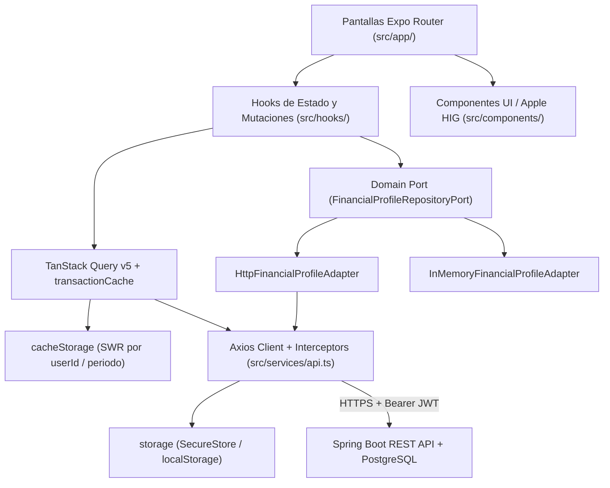

# ✨ Zentia — Finanzas Personales Multiplataforma

> **Claridad financiera en cada movimiento.** Aplicación móvil y web (`iOS`, `Android` y `Web`) orientada a registrar ingresos, gastos y metas de ahorro sin fricción, con arquitectura desacoplada, caché consistente y experiencia visual OLED estilo Apple HIG. 🚀

---

## Tabla de Contenidos

1. [Qué es y Propósito](#qué-es-y-propósito)
2. [Stack Tecnológico](#stack-tecnológico)
3. [Arquitectura Frontend](#arquitectura-frontend)
4. [Estrategia de Caché, Optimistic UI y Skeletons](#estrategia-de-caché-optimistic-ui-y-skeletons)
5. [Integración con Backend (REST + JWT)](#integración-con-backend-rest--jwt)
6. [Trade-offs de Diseño y Decisiones Técnicas](#trade-offs-de-diseño-y-decisiones-técnicas)
7. [Estructura del Proyecto](#estructura-del-proyecto)
8. [Configuración, Comandos y Despliegue](#configuración-comandos-y-despliegue)

---

## Qué es y Propósito

**Zentia** resuelve un problema cotidiano en herramientas de finanzas personales: la alta fricción para capturar movimientos diarios y la falta de visibilidad inmediata del balance real frente a una meta de ahorro mensual.

El cliente está diseñado bajo tres pilares:

- **Captura rápida con validación de dominio en cliente:** obliga montos estrictamente positivos (`RN-FIN-01`), filtra categorías compatibles por tipo de movimiento (`RN-FIN-03`) y normaliza contratos entre cliente y API.
- **Resiliencia ante latencia o cold-starts:** implementa hidratación síncrona en Web, caché con TTL por usuario y periodo, y skeletons OLED que reemplazan estados en `$0.00` durante cargas lentas en Render.
- **Paridad Multiplataforma con enfoque Mobile-First:** un mismo codebase con Expo Router sirve bundles estáticos en Vercel (`max-w-md` centrado en escritorio) y experiencia nativa en iOS/Android con Keychain/Keystore y desbloqueo biométrico (Face ID / Touch ID).

---

## Stack Tecnológico

| Capa | Tecnología | Versión / Detalle en repo |
| :--- | :--- | :--- |
| **Core & Runtime** | Expo SDK / React Native / React | `expo ~57.0.29` · `react-native 0.86.3` · `react 19.2.3` |
| **Navegación** | Expo Router (file-based + static web) | `expo-router ~57.0.27` |
| **Estilos & Sistema Visual** | NativeWind v4 + Tailwind CSS | `nativewind ^4.2.7` · `tailwindcss ^3.4.19` |
| **Estado Remoto & Caché** | TanStack Query v5 + `cacheStorage` | `@tanstack/react-query ^5.104.5` |
| **Red & Auth** | Axios + `@react-oauth/google` | `axios ^1.20.0` · `@react-oauth/google ^0.13.5` |
| **Seguridad Nativa** | `expo-secure-store` + `expo-local-authentication` | Cifrado hardware en móvil y bloqueo biométrico |
| **Tipado** | TypeScript | `typescript ~6.0.3` (`strict` via `pnpm tsc --noEmit`) |

---

## Arquitectura Frontend

El proyecto separa estrictamente el **enrutamiento**, la **capa de presentación**, la **gestión de estado/caché** y el **dominio/infraestructura**:



### Principios aplicados

1. **Separación de rutas vs lógica (`src/app/` delgado):**
   - `(auth)`: bienvenida, login con Google OAuth y respaldo OTP por teléfono.
   - `(onboarding)`: wizard de 3 pasos + resumen que persiste ingreso base, meta del 20% y categoría prioritaria.
   - `(tabs)`: Dashboard, Historial filtrable/buscable y Perfil.
   - `(modal)`: sheets modales (`presentation: 'modal'`) para alta y edición de transacciones.
2. **Ports & Adapters (Hexagonal) en Perfil Financiero:**
   - `FinancialProfile` (`src/domain/models/FinancialProfile.ts`) y `FinancialProfileRepositoryPort` (`src/domain/ports/FinancialProfileRepositoryPort.ts`) aíslan las pantallas del origen de datos.
   - `HttpFinancialProfileAdapter` sincroniza con Spring Boot (`/users/financial-profile` y `/users/onboarding`), mientras `InMemoryFinancialProfileAdapter` mantiene copia aislada bajo su propia llave (`zentia_financial_profile`) sin colisionar nunca con `zentia_user_data`.
3. **Ciclo de sesión e interceptor centralizado (`AuthContext` + `api.ts`):**
   - Al arrancar (`bootstrap`), `AuthProvider` valida la integridad del objeto usuario guardado (`isValidStoredUser`), restaura el token inmediatamente y ejecuta `syncSessionWithBackend` contra `GET /users/financial-profile` para mantener sincronizado `onboardingCompleted` y reparar sesiones incompletas.
   - Cualquier respuesta HTTP `401` dispara `storage.clearSession()`, limpia todas las cachés privadas (`cacheStorage.clearUserCaches()`), resetea `QueryClient` vía `setUnauthorizedHandler` y redirige a `/(auth)/login`.

---

## Estrategia de Caché, Optimistic UI y Skeletons

Para eliminar parpadeos en `$0.00`, desincronizaciones entre pantallas y lecturas obsoletas tras recargar en Web, el cliente implementa una caché de dos niveles:

### 1. Caché SWR aislada por cuenta y periodo (`src/services/cacheStorage.ts`)

- **Scope estricto:** las llaves se construyen mediante `buildAuthCacheScope(isAuthenticated, user?.id)` (`user_<id>` o `demo`). Al cerrar sesión o expirar el JWT (`401`), `clearUserCaches()` elimina únicamente las llaves privadas y conserva catálogos públicos (`categories`).
- **TTLs definidos por volatilidad:**
  - Resumen de dashboard e historial por `[startDate, endDate]`: `staleTime` de 2 minutos en memoria (`gcTime` de 30 minutos) y snapshot local con TTL de 10 minutos.
  - Perfil financiero: `staleTime` de 5 minutos y snapshot de 15 minutos.
  - Catálogo de categorías: `staleTime` de 30 minutos y snapshot de 24 horas.

### 2. Sincronización atómica de mutaciones (`src/services/transactionCache.ts`)

Alta, edición y eliminación (`useCreateTransaction`, `useUpdateTransaction`, `useDeleteTransaction`) comparten un flujo único para evitar inconsistencias entre el listado de movimientos y `BalanceCard`:

1. **`onMutate`:** cancela queries activas (`transactions`, `dashboard`), toma un snapshot completo (`captureTransactionSnapshot`) y aplica cambios optimistas en todos los rangos `[startDate, endDate]` afectados recalculando `totalIngresos`, `totalGastos` y `balanceActual`.
2. **`onError`:** revierte exactamente al estado anterior (`restoreTransactionSnapshot`) si el backend rechaza la operación. En modo autenticado los errores no se ocultan con registros falsos.
3. **`onSuccess` / `onSettled`:** sustituye IDs temporales optimistas por los devueltos por el servidor e invalida queries para que PostgreSQL mantenga la última palabra.

### 3. Skeletons OLED ante carga real (`src/components/ui/Skeleton.tsx`)

- Cuando un periodo no tiene snapshot previo en caché (primer acceso o cambio a *Mes Anterior* / *Personalizado*), `useDashboardSummary` omite `keepPreviousData` entre rangos distintos para no mostrar cifras del mes equivocado bajo otro título.
- Durante esa ventana de carga se muestran `BalanceCardSkeleton`, `SavingsGoalSkeleton` y `TransactionListSkeleton` animados a 60 FPS, evitando estados vacíos falsos (*"Sin movimientos"*) mientras responde el servidor.

---

## Integración con Backend (REST + JWT)

El frontend consume una API REST en Spring Boot (`EXPO_PUBLIC_API_URL`, por defecto `https://zentia-backend-5l77.onrender.com/api/v1`) con autenticación stateless mediante header `Authorization: Bearer <TOKEN_JWT>`.

| Módulo | Método y Endpoint | Uso en Frontend |
| :--- | :--- | :--- |
| Identidad | `POST /auth/google` | Intercambia perfil/token de Google por JWT de Zentia y bandera `onboardingCompleted`. |
| Identidad | `POST /auth/otp/solicitar` / `verificar` | Flujo alternativo por teléfono con sincronización posterior de perfil. |
| Onboarding & Perfil | `POST /users/onboarding` | Persiste `monthlyIncome`, `monthlySavingsGoal`, `priorityCategoryId` y marca `onboardingCompleted = true`. |
| Onboarding & Perfil | `GET /users/financial-profile` | Hidrata metas en Dashboard/Perfil y valida vigencia de sesión al reiniciar. |
| Catálogo | `GET /categories` | Sincroniza categorías reales (`1..13`) con tipo `INGRESO` / `GASTO`. |
| Transacciones | `POST /transactions` | Crea movimiento normalizando `INCOME`/`EXPENSE` a `INGRESO`/`GASTO`. |
| Transacciones | `PUT /transactions/{id}` | Actualiza categoría, monto y descripción sin mutar el tipo original. |
| Transacciones | `DELETE /transactions/{id}` | Elimina movimiento y recalcula métricas del periodo. |
| Dashboard | `GET /transactions/dashboard` | Obtiene agregados (`totalIngresos`, `totalGastos`, `balanceActual`) por rango `[startDate, endDate]`. |
| Historial | `GET /transactions/historial` | Obtiene lista cronológica filtrada por `[startDate, endDate]`. |

---

## Trade-offs de Diseño y Decisiones Técnicas

| Decisión adoptada | Alternativa descartada | Justificación técnica y compromiso |
| :--- | :--- | :--- |
| **Bearer JWT en `SecureStore` (móvil) / `localStorage` (Web)** | Cookies `HttpOnly` con `withCredentials` | Permite compartir exactamente el mismo cliente Axios entre React Native nativo y Web cross-origin (Vercel ↔ Render) sin fricción de `SameSite`. Compromiso: en Web depende de higiene contra XSS, mitigado por ausencia de `dangerouslySetInnerHTML`, tokens de 24h y limpieza automática en `401`. |
| **`cacheStorage` (`localStorage`/RAM) separado de `SecureStore`** | Persistir toda la caché de TanStack Query dentro de `SecureStore` | `SecureStore` en iOS/Android impone un límite aproximado de ~2 KB por entrada y no es síncrono. Separar credenciales cifradas de snapshots de UI evita fallos de tamaño en nativo y habilita hidratación síncrona en frame 0 en Web. |
| **`@react-oauth/google` en Web + OTP/Demo en móvil** | SDK nativo de Google Sign-In desde el primer sprint | Desbloqueó pruebas reales con el backend sin requerir builds nativos (`EAS Dev Client` / `GoogleService-Info.plist`) durante desarrollo ágil. Compromiso: el botón nativo de Google en iOS/Android queda pendiente para build nativo de producción. |
| **Animaciones base sobre `Animated` + `cssInterop`** | Usar `react-native-reanimated` en todos los wrappers de layout | Evita errores de inicialización de worklets durante el static rendering SSR de `expo export -p web` manteniendo transiciones spring fluidas (`SpringPressable`, `FadeSlideIn`, `SkeletonBox`). |
| **Sin `keepPreviousData` entre rangos de fechas distintos** | Mantener datos del periodo previo mientras carga el nuevo | Mostrar totales de *Este Mes* bajo la etiqueta *Mes Anterior* durante un cold-start induce errores de lectura financiera. Mostrar el skeleton específico del card garantiza integridad visual. |
| **Rollback estricto en mutaciones autenticadas** | Fallback silencioso a datos locales ante errores HTTP | En modo autenticado ocultar un `400`/`500` crea datos fantasma que desaparecen al recargar. Se optó por rollback inmediato + notificación de error real, reservando la creación local exclusivamente para Modo Demo. |

---

## Estructura del Proyecto

```text
zentia-frontend/
├── src/
│   ├── app/                        # Rutas Expo Router (auth, onboarding, tabs, modal)
│   ├── components/
│   │   ├── auth/                   # GoogleAuthProviderWrapper, BiometricLockGate
│   │   ├── dashboard/              # BalanceCard, PeriodSelector, RecentTransactions, GuidedTutorialCard
│   │   ├── finance/                # MoneyInput, CategoryPicker, SegmentedTypeControl
│   │   ├── layout/                 # ResponsiveAppShell (max-w-md web container)
│   │   └── ui/                     # Skeleton, SpringPressable, FadeSlideIn, KaluriEasterEgg
│   ├── context/                    # AuthContext (bootstrap, OAuth, OTP, 401 handler)
│   ├── domain/                     # Modelos puros y puertos (Hexagonal Architecture)
│   ├── infrastructure/adapters/    # HttpFinancialProfileAdapter & InMemoryFinancialProfileAdapter
│   ├── hooks/                      # useDashboard, useCategories, useFinancialProfile y mutaciones
│   ├── services/                   # api.ts, storage.ts, cacheStorage.ts, transactionCache.ts, biometrics.ts
│   ├── types/                      # Contratos DTO TypeScript alineados con Spring Boot
│   └── utils/                      # Formateo monetario tabular
├── docs/                           # PRD.md, SPRINTS.md, QA_CHECKLIST.md
├── AGENTS.md                       # Directivas técnicas, tokens Figma y guías Apple HIG
└── vercel.json                     # Build estático Web y rewrites SPA
```

---

## Configuración, Comandos y Despliegue

### Variables de Entorno

Copia `.env.example` a `.env` y define los valores correspondientes:

```env
EXPO_PUBLIC_API_URL=https://zentia-backend-5l77.onrender.com/api/v1
EXPO_PUBLIC_GOOGLE_CLIENT_ID=<tu-client-id-web>.apps.googleusercontent.com
EXPO_PUBLIC_DEMO_URL=https://zentia.vercel.app
```

> Nota: Para Google OAuth en Web es necesario autorizar el origen (`http://localhost:8081` en local y el dominio de producción en Vercel) dentro de Google Cloud Console.

### Comandos de Desarrollo y Verificación

```bash
# Instalar dependencias
pnpm install

# Iniciar servidor de desarrollo (Web / iOS / Android)
pnpm start

# Verificación estricta de tipos TypeScript
pnpm tsc --noEmit

# Generar bundle estático Web (17 rutas en dist/)
npx expo export -p web
```

### Despliegue en Vercel (Web)

`vercel.json` configura el build estático automático mediante `npx expo export -p web` sirviendo `dist/` con `cleanUrls: true` y fallback hacia `/index.html`.
