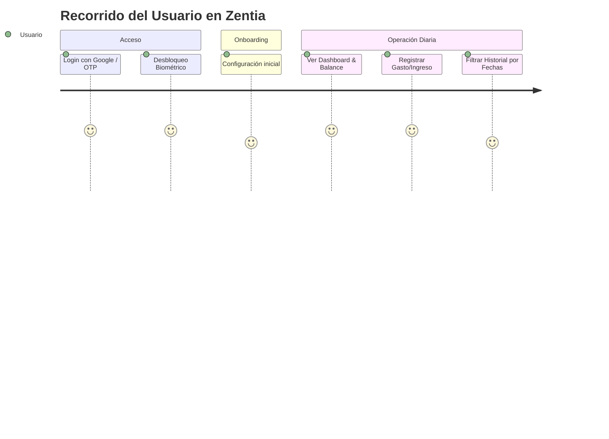
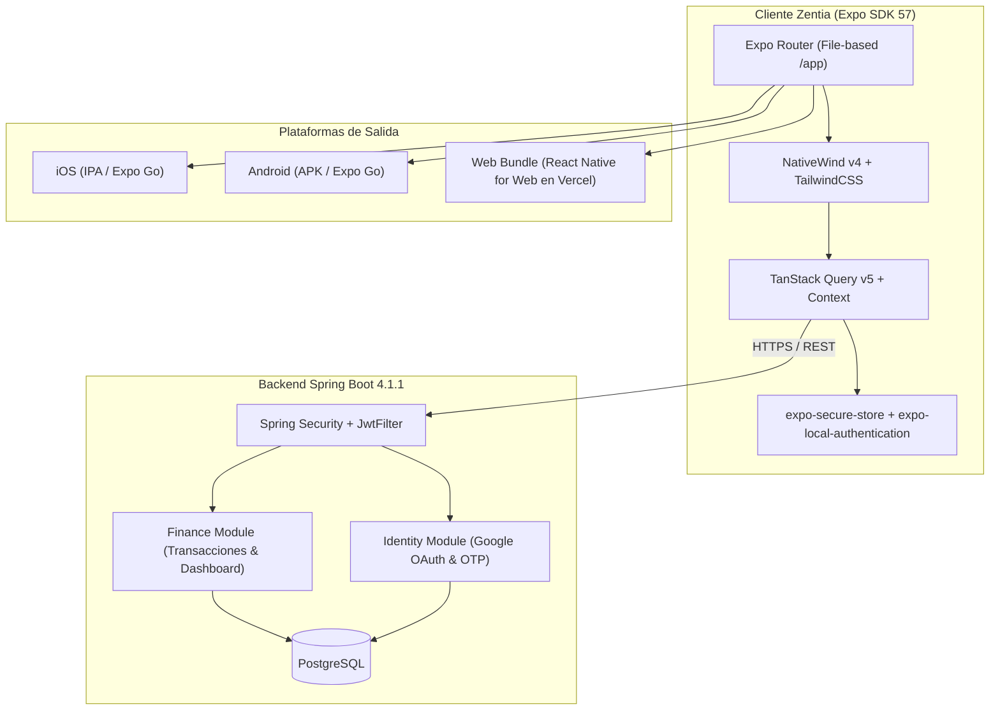

# 📋 Documento de Requisitos de Producto (PRD) — Zentia Mobile & Web

---

## 1. Visión del Producto y Objetivos

### 1.1 Declaración de Visión
**Zentia** es una plataforma móvil y web de finanzas personales diseñada para brindar control, visibilidad y claridad patrimonial instantánea a usuarios jóvenes y profesionales. Proporciona una experiencia fluida a 60/120 FPS, arquitectura sin fricción mental, soporte biométrico nativo y visualización clara de ingresos, gastos y balance neto.

### 1.2 Objetivos Estratégicos y Métricas de Éxito
| Objetivo | Métrica / KPI | Criterio de Aceptación |
|---|---|---|
| **Rendimiento Nativo** | Tasa de refresco y tiempos de renderizado | Listas de transacciones y dashboard operando a 60/120 FPS estables sin tirones en scroll ni animaciones. |
| **Seguridad de Grado Financiero** | Almacenamiento y autenticación | Tokens JWT cifrados con hardware Keystore/Keychain (`expo-secure-store`); desbloqueo biométrico Face ID / Huella (`expo-local-authentication`). |
| **Cero Fricción en Demos (Stand)** | Accesibilidad de prueba | Demostración nativa en dispositivo móvil y despliegue web simultáneo (Vercel) accesible por código QR en < 3 segundos sin instalación de APK. |
| **Resiliencia y Caché** | Gestión de estado remoto | Uso de TanStack Query para persistencia optimista, invalidación automática y revalidación en segundo plano contra el backend Spring Boot. |

---

## 2. Personas de Usuario y Casos de Uso Principales

1. **El Ahorrador Práctico (Estudiante / Joven Profesional)**:
   * Necesita registrar transacciones en segundos (menos de 3 toques).
   * Requiere ver inmediatamente si sus gastos superan sus ingresos del mes actual.
2. **El Evaluador / Visitante en Stand**:
   * Requiere interactuar con la app instantáneamente escaneando un código QR desde su navegador móvil.
   * Prueba formularios, gráficos y velocidad de respuesta sin crear cuentas complejas.

---

## 3. Arquitectura Técnica y Stack

### 3.1 Diagrama de Arquitectura

### 3.2 Componentes Tecnológicos
* **Framework**: React Native 0.86, React 19, Expo SDK 57.
* **Navegación**: Expo Router v57 (enfoque de carpetas tipo Next.js App Router).
* **Estilos**: NativeWind v4 (TailwindCSS 3.4 adaptado a primitivas nativas).
* **Gestión de Datos y Caché**: `@tanstack/react-query` v5 + `axios`.
* **Criptografía y Bóveda**: `expo-secure-store` (móvil) con fallback seguro en Web.
* **Autenticación Biométrica**: `expo-local-authentication`.
* **Backend de Consumo**: Spring Boot 4.1.1 en Java 21, persistencia en PostgreSQL (`zentia_db`).

---

## 4. Matriz de Reglas de Negocio del Sistema

| Código | Regla | Impacto en Frontend | Manejo de Excepciones / Fallback |
|---|---|---|---|
| **RN-02** | **Correo obligatorio, único y máx. 100 caracteres** | Validación previa en cliente antes del submit. Longitud restringida y regex de formato. | Si el backend responde error de conflicto/duplicidad, mostrar toast/banner de advertencia específico. |
| **RN-04** | **Onboarding inicial incompleto** | Si `onboardingCompleted === false`, redirigir obligatoriamente al flujo `(onboarding)` antes de desbloquear el dashboard. | Guardar estado en memoria/storage para evitar loops de navegación. |
| **RN-07** | **Operaciones protegidas requieren autenticación válida** | Interceptor de peticiones HTTP en Axios inyectando cabecera `Authorization: Bearer <TOKEN>`. | Ante HTTP 401: limpiar sesión en `expo-secure-store`, resetear caché de React Query y redirigir a `/(auth)/login`. |
| **RN-FIN-01** | **Montos estrictamente mayores a cero** | Campo numérico con validación en tiempo real; formateo de moneda con 2 decimales. | Bloquear botón de envío si el monto ingresado es <= 0. |
| **RN-FIN-02** | **Aislamiento por usuario (Anti-IDOR)** | El cliente jamás envía `userId` en el cuerpo o query de transacciones. El backend resuelve la identidad por el JWT. | Simplifica los DTOs de envío y previene manipulación de datos ajenos. |
| **RN-FIN-03** | **Coherencia de Catálogo de Categorías** | Al crear una transacción tipo `INGRESO`, solo habilitar categorías de tipo `INGRESO`. Lo análogo para `GASTO`. | Filtrado en memoria de categorías activas para evitar inconsistencias de dominio. |

---

## 5. Especificación Detallada de Módulos y Funcionalidades

### 5.1 Módulo de Identidad y Acceso (`/(auth)`)
* **Login Social (Google OAuth 2.0)**:
  * Integración con flujo de autenticación de Google.
  * Consumo del endpoint `POST /api/v1/auth/google`.
  * Recepción de `{ token, userId, email, name, onboardingCompleted, isNewUser }`.
* **Login de Respaldo por OTP**:
  * Pantalla de ingreso de número telefónico (formato internacional E.164, ej. `+523312345678`).
  * Consumo de `POST /api/v1/auth/otp/solicitar`.
  * Pantalla con selector de 6 pines numéricos y cuenta regresiva de reenvío.
  * Consumo de `POST /api/v1/auth/otp/verificar` y guardado de sesión.
* **Seguridad Biométrica y Almacenamiento de Tokens**:
  * Almacenamiento seguro del JWT mediante `expo-secure-store`.
  * Pantalla de desbloqueo biométrico opcional configurable en ajustes.

### 5.2 Módulo de Onboarding (`/(onboarding)`)
* Carrusel interactivo explicando el propósito de Zentia (Registro rápido, métricas y control financiero).
* Captura y vinculación opcional de teléfono de respaldo vía `PUT /api/v1/users/profile/phone`.
* Transición hacia las pestañas principales (`/(tabs)`).

### 5.3 Módulo Dashboard y Analítica (`/(tabs)/index`)
* **Tarjetas de Balance Principal**:
  * Balance Neto Actual (`balanceActual = totalIngresos - totalGastos`).
  * Card de Ingresos del Periodo (`totalIngresos`).
  * Card de Gastos del Periodo (`totalGastos`).
  * Indicador de saldo positivo (verde) o negativo (rojo).
* **Selector de Periodo Temporal**:
  * Filtros preestablecidos: "Este Mes", "Mes Anterior", "Personalizado".
  * Parámetros dinámicos `startDate` y `endDate` (`YYYY-MM-DD`) para `GET /api/v1/transactions/dashboard`.
* **Acciones Rápidas (Floating / Header Action)**:
  * Botón directo "+ Ingreso" y "+ Gasto" para modal de registro rápido.
* **Listado de Últimos Movimientos**:
  * Vista previa de las 5 transacciones más recientes con enlace al historial completo.

### 5.4 Módulo de Transacciones e Historial (`/(tabs)/transactions`)
* **Registro de Transacción (Modal / Screen `/(modal)/new-transaction`)**:
  * Selector tab: `GASTO` vs `INGRESO`.
  * Input de monto con máscara monetaria.
  * Selector horizontal de categorías con icono representativo (`Category.icon`).
  * Input de descripción opcional (máx. 255 caracteres).
  * Selector de fecha (`transactionDate`), con valor por defecto la fecha actual.
  * Mutación optimista en React Query con refresco automático del dashboard.
* **Historial Detallado y Búsqueda**:
  * Lista virtualizada nativa (`FlashList` o `FlatList`) para 60/120 FPS.
  * Agrupación por días/fechas.
  * Deslizar para eliminar (*Swipe to Delete*) con confirmación y llamada a `DELETE /api/v1/transactions/{id}`.
  * Tap para editar con consumo de `PUT /api/v1/transactions/{id}`.

### 5.5 Módulo de Perfil y Ajustes (`/(tabs)/profile`)
* Tarjeta de usuario: avatar, nombre, correo y estado de teléfono vinculado.
* Opción de vincular/actualizar número telefónico.
* Interruptor de seguridad para requerir Face ID / Huella al abrir la app.
* Opción para cerrar sesión (destrucción segura de token en Keychain y purga de caché).

---

## 6. Referencia al Plan de Sprints
El desglose operativo de tareas, dependencias, entregables y criterios de aceptación por cada sprint se encuentra centralizado en:
👉 [SPRINTS.md](file:///Users/uriel/Desktop/dev/Zentia/zentia-frontend/docs/SPRINTS.md)

---

## 7. Criterios de Aceptación y Calidad

1. **Robustez de Red**: El cliente debe mostrar estados de carga (`Skeleton` o indicadores de actividad) y manejar estados vacíos cuando no existan transacciones.
2. **Seguridad**: Ningún token o dato sensible debe persistirse en texto plano no cifrado en móvil.
3. **Consistencia Visual**: Modo claro y oscuro soportado fluidamente a través de clases utilitarias de NativeWind (`dark:`).
4. **Verificación Estricta**: Cada tarea de código debe pasar `pnpm tsc --noEmit` y `npx expo lint` con 0 errores antes de cerrarse.
