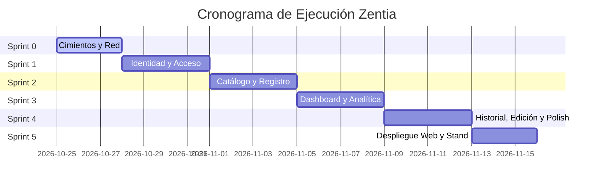

# 🏃 Zentia — Plan de Sprints y Backlog de Tareas

Este documento detalla la planificación de ejecución incremental para el cliente móvil y web de **Zentia**, organizado en 6 sprints progresivos alineados con el [PRD](file:///Users/uriel/Desktop/dev/Zentia/zentia-frontend/docs/PRD.md) y los tokens de diseño de [AGENTS.md](file:///Users/uriel/Desktop/dev/Zentia/zentia-frontend/AGENTS.md).

---

## 📅 Cronograma General de Sprints

---

## 📌 Sprint 0: Cimientos Arquitectónicos y Cliente de Red
* **Objetivo:** Dejar una base tipada, modular y desacoplada para comunicación HTTP y almacenamiento seguro de credenciales.
* **Entregables:** Cliente Axios tipado con interceptores, servicio de bóveda cifrada, `QueryClient` de TanStack y entidades de dominio en TypeScript.

| ID | Tarea / Feature | Archivo(s) | Dependencias | Estado |
|---|---|---|---|---|
| **TASK-001** | Definición de tipos de dominio (`User`, `Category`, `Transaction`, `TransactionType`, `DashboardSummary`, `AuthResponse`) | `src/types/api.ts` | Ninguna | ✅ Completado |
| **TASK-002** | Servicio de almacenamiento seguro (`storage.ts`) envolviendo `expo-secure-store` y fallback seguro para Web (`localStorage`) | `src/services/storage.ts` | `expo-secure-store` | ✅ Completado |
| **TASK-003** | Cliente HTTP centralizado (`api.ts`) con inyección de JWT en cabecera `Authorization` e interceptor de error 401 | `src/services/api.ts` | TASK-002, `axios` | ✅ Completado |
| **TASK-004** | Configuración del proveedor global `QueryClientProvider` de TanStack Query en el árbol de navegación | `src/app/_layout.tsx` | `@tanstack/react-query` | ✅ Completado |

* **Criterio de Aceptación del Sprint 0:**
  * `pnpm tsc --noEmit` y `npx expo lint` ejecutados con 0 errores.
  * Pruebas de guardado/recuperación en almacenamiento seguro funcionando tanto en simulador nativo como en navegador web.

---

## 📌 Sprint 1: Módulo de Identidad y Autenticación
* **Objetivo:** Implementar el acceso completo con Google OAuth 2.0 y el login de respaldo telefónico (OTP), junto con el flujo inicial de Onboarding (RN-02, RN-04, RN-07).
* **Entregables:** Pantalla de Splash, pantalla de Login, verificación OTP, navegación protegida y onboarding de 3 pasos con diseño de Figma.

| ID | Tarea / Feature | Archivo(s) | Dependencias | Estado |
|---|---|---|---|---|
| **TASK-101** | Contexto y hook global `AuthContext` (`useAuth`) para gestionar sesión, token JWT y datos de usuario | `src/context/AuthContext.tsx` | TASK-002, TASK-003 | ✅ Completado |
| **TASK-102** | Pantalla de bienvenida / Splash según Figma (`"Z E N T I A"`, subtítulo y botón pill "COMENZAR") | `src/app/index.tsx` | Design tokens | ✅ Completado |
| **TASK-103** | Pantalla de Login (`/(auth)/login.tsx`) con botón oficial de Google OAuth y acceso a login por teléfono | `src/app/(auth)/login.tsx` | TASK-101 | ✅ Completado |
| **TASK-104** | Flujo de login por OTP: solicitud telefónica y selector de 6 dígitos numéricos con cuenta regresiva | `src/app/(auth)/otp.tsx` | TASK-101, `/api/v1/auth/otp/*` | ✅ Completado |
| **TASK-105** | Onboarding guiado en 3 pasos con barra segmentada verde `#22C55E` y tarjeta de éxito ("¡Todo listo!") | `src/app/(onboarding)/index.tsx` | Figma specs | ✅ Completado |
| **TASK-106** | Guardianes de ruta en Expo Router: redirección automática a `/(auth)/login` si no hay token válido | `src/app/_layout.tsx` | TASK-101 | ✅ Completado |

* **Criterio de Aceptación del Sprint 1:**
  * Al ingresar credenciales de Google o verificar OTP, se almacena el JWT en Keychain y se redirige al onboarding si `onboardingCompleted === false`.
  * La interfaz respeta exactamente la paleta OLED `#000000`, botones pill y barra segmentada de Figma.

---

## 📌 Sprint 2: Catálogo de Categorías y Registro de Transacciones
* **Objetivo:** Permitir el registro ágil de ingresos y gastos con validaciones en tiempo real y catálogo categorizado (RN-FIN-01, RN-FIN-02, RN-FIN-03).
* **Entregables:** Hook de catálogo con caché persistente, modal de creación con máscara monetaria y mutación optimista.

| ID | Tarea / Feature | Archivo(s) | Dependencias | Estado |
|---|---|---|---|---|
| **TASK-201** | Hook `useCategories` consumiendo `GET /api/v1/categories` con caché persistente en React Query | `src/hooks/useCategories.ts` | TASK-003 | ⏳ Pendiente |
| **TASK-202** | Componentes de formulario reutilizables: `MoneyInput`, `CategoryPill`, `SegmentedTypeControl` | `src/components/finance/*` | NativeWind | ⏳ Pendiente |
| **TASK-203** | Modal de registro rápido `/(modal)/new-transaction`: selección de tipo (`INGRESO`/`GASTO`), monto, categoría y fecha | `src/app/(modal)/new-transaction.tsx` | TASK-201, TASK-202 | ⏳ Pendiente |
| **TASK-204** | Mutación `POST /api/v1/transactions` con actualización optimista de caché e invalidación de dashboard | `src/hooks/useCreateTransaction.ts` | TASK-003 | ⏳ Pendiente |

* **Criterio de Aceptación del Sprint 2:**
  * Los montos menores o iguales a cero bloquean el envío.
  * Solo se muestran categorías compatibles con el tipo de transacción seleccionado.
  * El `userId` nunca viaja en el payload (Anti-IDOR garantizado).

---

## 📌 Sprint 3: Dashboard Financiero y Analítica Visual
* **Objetivo:** Mostrar métricas claras de salud financiera (balance neto, ingresos y gastos) con filtro dinámico por rango de fechas.
* **Entregables:** Pantalla principal del dashboard con selector de periodos ("Este Mes", "Mes Anterior", etc.) y visualizaciones numéricas.

| ID | Tarea / Feature | Archivo(s) | Dependencias | Estado |
|---|---|---|---|---|
| **TASK-301** | Hook `useDashboardSummary(startDate, endDate)` consumiendo `GET /api/v1/transactions/dashboard` | `src/hooks/useDashboard.ts` | TASK-003 | ⏳ Pendiente |
| **TASK-302** | Tarjetas de métricas: Balance Neto con color condicional (verde positivo / rojo negativo), Ingresos Totales y Gastos Totales | `src/components/dashboard/BalanceCard.tsx` | Design tokens | ⏳ Pendiente |
| **TASK-303** | Selector dinámico de periodo temporal (Este mes, Mes anterior, Rango personalizado) | `src/components/dashboard/PeriodSelector.tsx` | UI tokens | ⏳ Pendiente |
| **TASK-304** | Lista rápida de "Últimos Movimientos" en el dashboard con acceso directo a la vista de historial | `src/components/dashboard/RecentTransactions.tsx` | Sprint 2 | ⏳ Pendiente |

* **Criterio de Aceptación del Sprint 3:**
  * El cambio de mes en el selector actualiza instantáneamente los totales sin parpadeo de pantalla.
  * Formato monetario internacional consistente (`$ XX,XXX.XX`).

---

## 📌 Sprint 4: Historial Completo, Edición, Biometría y Perfil
* **Objetivo:** Habilitar gestión completa del historial (búsqueda, edición y eliminación de transacciones) y seguridad biométrica nativa (Face ID / Huella).
* **Entregables:** Pantalla de historial virtualizada a 60/120 FPS, swipe-to-delete, modal de edición, desbloqueo biométrico y ajustes de perfil.

| ID | Tarea / Feature | Archivo(s) | Dependencias | Estado |
|---|---|---|---|---|
| **TASK-401** | Pantalla de historial `src/app/(tabs)/transactions.tsx` con agrupación por fecha y scroll fluido | `src/app/(tabs)/transactions.tsx` | Virtualized list | ⏳ Pendiente |
| **TASK-402** | Edición de transacciones (`PUT /api/v1/transactions/{id}`) permitiendo cambiar monto, categoría y descripción | `src/hooks/useUpdateTransaction.ts` | Sprint 2 | ⏳ Pendiente |
| **TASK-403** | Eliminación de transacciones con confirmación y consumo de `DELETE /api/v1/transactions/{id}` | `src/hooks/useDeleteTransaction.ts` | Sprint 2 | ⏳ Pendiente |
| **TASK-404** | Desbloqueo biométrico con `expo-local-authentication` al abrir la aplicación | `src/services/biometrics.ts` | `expo-local-authentication` | ⏳ Pendiente |
| **TASK-405** | Pantalla de perfil (`src/app/(tabs)/profile.tsx`) con datos del usuario, switch biométrico y logout seguro | `src/app/(tabs)/profile.tsx` | TASK-101 | ⏳ Pendiente |

* **Criterio de Aceptación del Sprint 4:**
  * Al eliminar una transacción, la lista y el dashboard se sincronizan de inmediato sin recargar toda la app.
  * Si la biometría está activa en ajustes, se solicita Face ID/Huella al regresar de segundo plano.

---

## 📌 Sprint 5: Optimización Web, Generador de QR y Preparación para Stand
* **Objetivo:** Preparar la entrega para el stand universitario con despliegue web público en Vercel y prueba física nativa en Expo Go.
* **Entregables:** Build web optimizado, URL pública en Vercel, código QR para posters y checklist de verificación integral.

| ID | Tarea / Feature | Archivo(s) | Dependencias | Estado |
|---|---|---|---|---|
| **TASK-501** | Verificación de responsive design en web: contenedores centrados con `max-w-md` y navegación adaptativa | `src/app/*` | Web styles | ⏳ Pendiente |
| **TASK-502** | Exportación de bundle web de producción con `npx expo export -p web` | Configuración Vercel | Expo Web | ⏳ Pendiente |
| **TASK-503** | Generación de componente y recurso de Código QR apuntando a la URL pública del demo | `docs/assets/demo-qr.png` | Web URL | ⏳ Pendiente |
| **TASK-504** | Prueba integral de carga y sincronización concurrente: dispositivo físico (iOS/Android con Expo Go) + navegador web | QA Checklist | Backend Spring Boot | ⏳ Pendiente |

* **Criterio de Aceptación del Sprint 5:**
  * Cualquier alumno o evaluador puede escanear el QR del stand y cargar la aplicación en su navegador móvil en menos de 3 segundos sin instalar ningún archivo.

---

## ✅ Definición de Terminado (Definition of Done - DoD)
Cada tarea se considerará finalizada únicamente cuando:
1. El código compile estrictamente sin errores mediante `pnpm tsc --noEmit`.
2. Las pruebas de linter pasen con `npx expo lint`.
3. Se respeten los colores y jerarquía visual del Design System de Figma ([`AGENTS.md`](file:///Users/uriel/Desktop/dev/Zentia/zentia-frontend/AGENTS.md#L43-L77)).
4. Los cambios queden registrados con un commit semántico convencional (sin atribuciones de IA).
